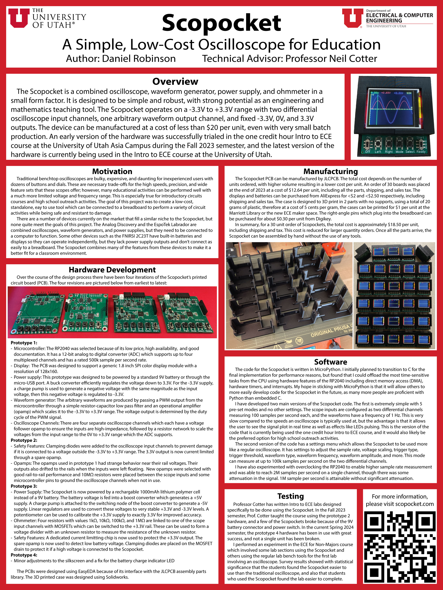

# Scopocket: A Low-Cost Oscilloscope for Education
Welcome to the GitHub repository for the Scopocket project. Here you can find the schematics, PCB fabrication files, and source code for the Scopocket. For additional information please visit [the documentation webpage.](https://scopocket.com)

- **`Firmware/`**: ready-to-flash firmware images:
  - `advanced_scopocket_firmware.uf2` is the current C firmware, and the one the companion app needs.
  - `simple_scopocket_firmware.uf2` is the original MicroPython firmware.
- **`Firmware/C/`**: source for the C firmware. See `Firmware/C/README.md` to build it.
- **`docs/app/`**: the Scopocket Companion web app, published at [scopocket.com/app](https://scopocket.com/app/).
- **`Firmware/MicroPython/`**: the original MicroPython firmware.
- **`Schematic/`, `PCB Design Files/`, `Case Design Files/`**: hardware design files.

