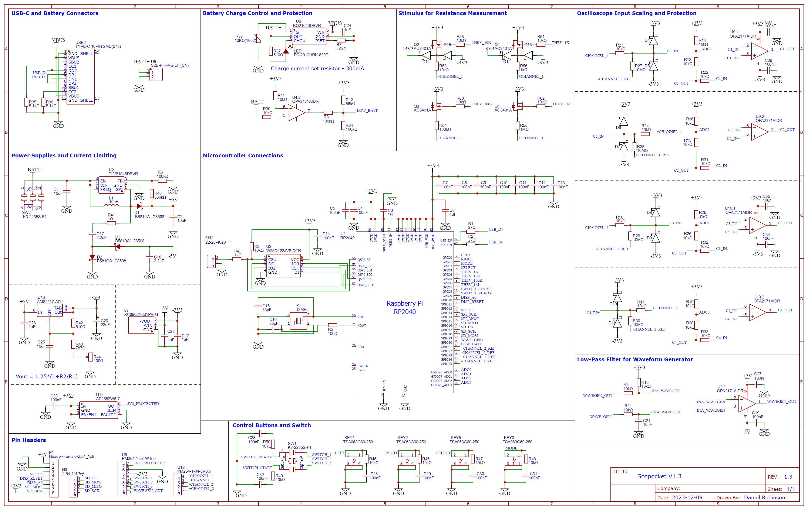

These specifications describe the Scopocket v1.3 hardware. What the Scopocket does with this hardware (sample rates, modes, measurements) is set by its firmware.

## Schematic

A full-resolution PDF of the schematic is [in the GitHub repository](https://github.com/Cutout1/scope/blob/main/Schematic/Scopocket%20Schematic%20V1.3.pdf), alongside the PCB design files.

## Summary

| | |
|---|---|
| Microcontroller | Raspberry Pi RP2040: dual-core Arm Cortex-M0+, 264 KB RAM |
| Program storage | 16 MB QSPI flash (Winbond W25Q128JV) |
| Display | 1.8" 160 × 128 colour TFT LCD (ST7735 controller, SPI) |
| Oscilloscope inputs | 2 differential channels (C1+/C1−, C2+/C2−), −3.3 V to +3.3 V on each pin |
| Analog-to-digital converter | 12-bit, 500 kS/s rated, shared by the four input pins |
| Waveform output | −3.3 V to +3.3 V, best suited to low frequencies (up to about 100 Hz) |
| Measurement stimulus | 3.3 V through 1 kΩ, 10 kΩ, 100 kΩ or 1 MΩ into C1+, for resistance and capacitance |
| Power outputs | +3.3 V (current-limited), −3.3 V, 0 V reference |
| Battery | Single-cell lithium-ion or lithium-polymer, 2.0 mm JST PH connector |
| Charging | USB-C, 300 mA, with charge indicator LED |
| USB | USB-C, USB 1.1 full speed (12 Mbit/s): charging, data, firmware updates |
| Controls | Power switch, four buttons (Left, Right, Mode, Select), trigger switch |

## Oscilloscope inputs

The Scopocket has two channels, each with a positive and a negative input. A channel measures the voltage *between* its two input pins (C1 = C1+ − C1−, and likewise for C2). Grounding the negative pin turns a channel into an ordinary ground-referenced input.

Each of the four input pins has its own identical front end:

- **Protection:** a 10 kΩ series resistor followed by clamp diodes to the ±3.3 V supply rails. Voltages beyond the supply rails are clamped, and the resistor limits the current that flows when they are.
- **Buffer:** a unity-gain op-amp buffer (Texas Instruments OPA2171, rail-to-rail output) running from ±3.3 V, so the input presents a very high impedance to the circuit under test.
- **Bias:** a 10 MΩ resistor to a microcontroller pin, normally held at 0 V. An unconnected input therefore reads 0 V instead of drifting. The microcontroller can release it to make the input fully high-impedance, which the resistance measurement uses.
- **Level shifting:** a 10 kΩ / 10 kΩ divider to +3.3 V maps the −3.3 V…+3.3 V input range onto the 0…3.3 V range of the microcontroller's analog-to-digital converter.

| | |
|---|---|
| Input range (each pin, relative to 0 V) | −3.3 V to +3.3 V |
| Channel range (difference between its pins) | up to ±6.6 V |
| Input resistance | about 10 MΩ |
| Resolution | 12 bits over 6.6 V: about 1.6 mV per step |
| Sampling | RP2040 ADC: 12-bit successive approximation, 500 kS/s rated, multiplexed between the four input pins |

Keep every input pin between −3.3 V and +3.3 V relative to the Scopocket's 0 V pin. Like most low-cost instruments, the Scopocket is **not isolated** and must never be connected to mains voltage.

## Waveform generator

The waveform output is produced by a pulse-width-modulated (PWM) signal from the microcontroller. A 10 kΩ / 10 nF low-pass filter (corner frequency about 1.6 kHz) smooths the PWM into an analog voltage. An op-amp stage (OPA2171, powered from ±5 V) then doubles it and shifts it down, so 0…3.3 V from the filter becomes −3.3 V…+3.3 V at the output pin.

Because of the low-pass filter, the output is best suited to low-frequency signals. Sine waves are clean up to about 100 Hz. Sharp edges, such as those of square and sawtooth waves, become visibly rounded as the frequency approaches that limit. The output is driven directly by the op-amp and is intended for circuits of about 1 kΩ and above.

## Resistance and capacitance stimulus

Four P-channel MOSFET switches (AO3401A) connect the +3.3 V supply to the C1+ input through 1 kΩ, 10 kΩ, 100 kΩ or 1 MΩ (1% tolerance) resistors. With an unknown resistor between C1+ and 0 V, the switched resistor and the unknown form a voltage divider, which gives the unknown resistance. The four values cover a wide range, from a few ohms to megohms. Switching one on and timing how the voltage rises with a capacitor connected instead gives its capacitance.

## Power outputs

| Pin | Output |
|---|---|
| 3.3 V output | +3.3 V through a current-limiting power switch (Diodes AP2552), limited to about 75 mA |
| 0 V reference | Ground |
| −3.3 V output | −3.3 V from a negative regulator (Torex XC6902), up to about 250 mA |

## Power system

- **Battery:** any single-cell lithium-ion or lithium-polymer battery that fits the case, on a 2.0 mm JST PH connector. A slide switch turns the Scopocket on and off.
- **Charging:** from the USB-C port by a Texas Instruments BQ21040 linear charger at 300 mA, with a charge indicator LED and temperature sensing.
- **Supply rails:**
  - A boost converter (Texas Instruments TLV61048) raises the battery voltage to +5 V.
  - A diode charge pump on the boost converter's switching node produces −5 V.
  - Linear regulators derive +3.3 V (AMS1117, trimmed by an on-board potentiometer) and −3.3 V (XC6902).
  - The RP2040's internal regulator provides its 1.1 V core supply.
- **Low-battery detection:** a comparator (the second half of an OPA2171) compares the battery voltage with 3.3 V and signals the microcontroller when the battery is running low.

## Controls and connectors

- **Buttons:** Left, Right, Mode and Select push buttons, each with an RC debouncing filter.
- **Trigger switch:** a double-pole slide switch. One pole tells the microcontroller whether it is in the Ready or Start position. The other pole is wired only to header pins 8–10, so it can also switch circuits under test (see the [pin reference](pin_reference.html)).
- **Pin headers:** an 11-pin connector on the edge of the board: four oscilloscope inputs, power outputs, the waveform output, and the trigger switch contacts. See the [pin reference](pin_reference.html) for the pinout.
- **Display connector:** an 8-pin header for the TFT display module.
- **Expansion header:** a 4-pin SPI header (chip select, clock, data in, data out) on spare microcontroller pins, intended for an SD card module.
- **USB-C:** charging, a USB 1.1 full-speed data connection, and drag-and-drop firmware updates through the RP2040's USB bootloader. A two-pin BOOTSEL connector next to the flash chip forces the bootloader at power-up.
